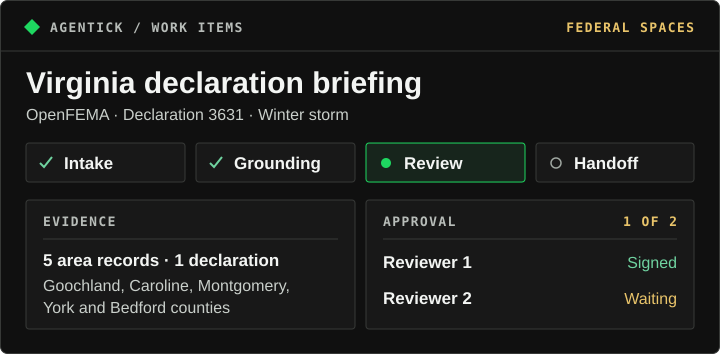

# Agentick | Federal Spaces demo

A public-sector analyst prepares a Virginia disaster briefing from OpenFEMA records. Two independent reviewers check the handoff before the team shares it. [View the presentation](https://agentick-presentation.vercel.app).



**Try the workflow.** Which Virginia counties appear in the OpenFEMA snapshot for declaration **3631**?

1. **Intake** — Open the printed work-item URL as the operator. The Virginia snapshot is attached.
2. **Grounding** — Select **Prepare analyst brief**. Check the five counties (Goochland, Caroline, Montgomery, York, and Bedford) against the cited snapshot, then **Submit for review**.
3. **Review** — Under **Account → Acting as**, switch to **Reviewer 1** and select **Approve this handoff**. One signature leaves it pending. Repeat as **Reviewer 2** to complete it.
4. **Handoff** — Download **Approval → Audit package → JSON**. The export includes the original draft, submitted text, and both reviewers’ decisions.

## Run the demo

With Node 22 and Corepack, clone and run the demo. No accounts or API keys are needed:

```powershell
git clone https://github.com/nsirivolu27/Agentick.AI.git
cd Agentick.AI
corepack pnpm install --frozen-lockfile
corepack pnpm build:workbench
corepack pnpm demo:openfema
```

Open the work-item URL printed in the terminal. After the second approval, run this in another terminal with the downloaded file’s path:

```powershell
corepack pnpm audit:verify "C:\path\to\downloaded-audit.json"
```

A successful check reports matching hashes and exits with code 0.

[Inspect the public source snapshot](examples/ontology/openfema/data/virginia-snapshot.json). The local demo uses a real OpenFEMA snapshot, a rule-based analyst, demo reviewers, and an offline replay of Foundry reads.
