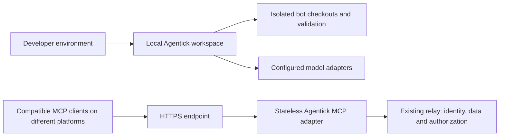

# Deployment and stack decision

## Company workspace container

The company image serves the application and its authenticated workspace APIs.
It is separate from the standalone relay adapter below and the offline
SageMaker evaluator in `docs/sagemaker-evaluation.md`. Do not deploy a demo entry
point as a company service.

Build from this repository with Node 22 and the pinned pnpm 10.26.1:

```powershell
corepack pnpm install --frozen-lockfile
corepack pnpm typecheck
corepack pnpm test
node deploy/build-workspace.mjs
$env:NODE_IMAGE = 'node@sha256:<reviewed-node22-image-digest>'
docker build -f deploy/workspace.Dockerfile --build-arg "NODE_IMAGE=$env:NODE_IMAGE" -t agentick-workspace:local .testbuild/workspace-image
```

The build helper rebuilds the browser and server and copies only named runtime
artifacts. Docker receives no source checkout, local data, credentials, demo
entry points or `node_modules`. Dependencies used by the company server are
bundled; no package installation happens when its container starts. Optional
dynamic provider SDKs used by other entry points are not included.

Supply these settings through the current shell or an access-restricted Compose
environment file outside Git. Do not paste real values into documentation:

| Setting | Required value |
| --- | --- |
| `NODE_IMAGE` | Approved and scanned Node 22 image pinned by digest |
| `MAGENTIC_PUBLIC_ORIGIN` | `http://127.0.0.1:4200` for local verification; HTTPS origin for deployment |
| `AGENTICK_ACCOUNTS_PATH` | Absolute path to the existing Clerk accounts JSON; mounted read-only |
| `MAGENTIC_CLERK_SECRET_KEY` | Clerk backend key for the same application |
| `MAGENTIC_CONNECTIONS_KEY` | Stable 64-character hexadecimal encryption key, backed up separately |
| `AGENTICK_HOST_PORT` | Optional local port, defaults to 4200 |

The accounts JSON must contain real `clerk.publishableKey`, `issuer`, RSA
`publicKey`, and `authorizedParties` including the exact public origin. Use
`members: []` and `companies: {}` for organization-based membership. Enable
Clerk Organizations and configure the company roles. Email domains alone never
grant access. Existing `MAGENTIC_*` setting names remain compatible with current
installations despite the Agentick product name.

```powershell
docker compose -f deploy/workspace-compose.yaml config --quiet
docker compose -f deploy/workspace-compose.yaml up -d --no-build
docker compose -f deploy/workspace-compose.yaml ps
Invoke-WebRequest http://127.0.0.1:4200/login -UseBasicParsing | Select-Object StatusCode
```

`config --quiet` validates without printing interpolated secrets. Keep environment
files private: Docker administrators can inspect container environment variables.
For AWS, inject secrets at task startup through the platform's secret manager;
never bake them into an image or place them in a public build argument.

The container runs as UID 1000, with a read-only root filesystem, dropped
capabilities, bounded resources and a named `/data` volume. The health check
requests `/login` with the configured host. It proves HTTP liveness only; the
authenticated `/api/health` reports workspace capabilities separately.

### Dependencies and deployment limits

| Component | Needed for |
| --- | --- |
| Node 22, pinned pnpm, TypeScript, esbuild | Building the existing source; no additional npm dependency introduced |
| MCP SDK, zod, React / React DOM | Existing runtime protocol, validation and browser rendering, bundled into the image |
| Docker Engine and Compose v2 | Building and running the local containers |
| Clerk application and Organizations | Real company login, roles and membership verification |
| Reachable model endpoint | Agent inference: company gateway, supported API provider, or separately hosted Ollama with a model installed |
| Persistent encrypted disk and protected vault key | Workspace state, stored connections and restart recovery |
| HTTPS reverse proxy / load balancer | Public access; preserve the original Host and Origin headers |
| AWS account, ECR, IAM, S3, KMS and SageMaker permissions | AWS image delivery and evaluation jobs; not provisioned by Compose |
| Foundry enrollment, ontology and scoped access | Required for the planned Foundry demonstration; unavailable until enrollment is granted |

Models are not downloaded or hosted inside the workspace image. A host Ollama
service is not reachable through container `127.0.0.1`; configure a reachable
endpoint deliberately. Provider credentials, model availability and authorization
must be tested with a real company user after deployment. Stripe and Jira /
Confluence / Slack credentials are needed only for the corresponding enabled
features; startup does not imply those integrations are connected.

Run **one writer per data volume**. Do not scale this filesystem-backed service
to multiple replicas or perform overlapping rolling replacements. Stop the old
container gracefully before starting its replacement. A hard crash can leave
`.writer.lock`; confirm no writer is alive before operator recovery. Do not
automatically delete that lock on startup. `docker compose down` preserves the
volume; `down -v` destroys it and must not be used against company data.

Back up the entire stopped `/data` volume and the separately held encryption key,
and test a restore into an isolated installation. The bundled
`workspace-backup-main.mjs` covers workflow state only, not all documents, Model
Studio records, company directory or connection vaults. A Docker volume is not a
backup. No multi-instance readiness, federal authorization or production capacity
is claimed by these containers.

### What another engineering team can use

Company mode provides organization access, persisted workflows, documents, model
connections, scheduled agents, review gates and configured automation adapters.
It intentionally does not enable host repository commands. The company entry
point also does not yet wire the Agent Studio test/package runtime available in
the demo. Container packaging does not close those product gaps.

For a complete engineering pipeline:

1. Configure company identity and independent reviewer roles; verify revocation
   and isolation using actual test accounts.
2. Connect an authorized model and workspace-scoped source/tools. Import the
   team's procedures and define stage input/output contracts.
3. Wire the test/package runtime into company mode with persistent tenant-scoped
   storage before offering create → test → approve → install there.
4. Connect repository and CI read tools with least-privilege access. Execute
   builds in disposable isolated workers, never in this application container.
5. Bind approved agent versions to workflow stages. Test failures, retries,
   content edits and independent approvals before enabling external writes.
6. Verify backup recovery, HTTPS, secrets and audit export in the deployment
   environment. Keep release/deployment writes behind their approval gates.

These are acceptance steps for a pilot, not claims that an arbitrary engineering
pipeline works immediately after cloning.

Agentick uses the Anthropic/OpenAI API track described in the supplied build
brief as its product direction. Keep the existing TypeScript, Node 22, zod and
MCP SDK foundation. Model providers remain adapters; Ollama stays available for
local work. A model selector does not establish that a provider is connected.
The browser UI stays in TypeScript and CSS; the installable shell is a separate
packaging step. No framework migration is needed to demonstrate this workflow.

## Two deployment boundaries



The local workbench owns its local session, project files and supervised bot
execution. It is not a multi-user cloud service. Do not expose the development
watcher or forward its bootstrap cookie to public clients.

The existing `dist/http-main.mjs` is the standalone hosted adapter. It accepts
each caller's relay credential and forwards authorized requests to the existing
LNKZ/LLMM relay. This deployment does not host the workflow UI, desktop bot
timeline or Jira review routes. Shared workflow storage and remote coding
workers require their own authorization and persistence design.

## Run the adapter container

Docker Engine and Compose are prerequisites. From the repository root:

```sh
export LNKZ_BASE_URL=https://your-relay.example.com
docker compose -f deploy/compose.yaml config --quiet
docker compose -f deploy/compose.yaml up --build -d
curl --fail http://127.0.0.1:8080/health
docker compose -f deploy/compose.yaml logs --tail=50 mcp
```

In PowerShell set `$env:LNKZ_BASE_URL` instead of using `export`.
Use a relay you operate or are authorized to access. The template starts with
read-only MCP scopes and binds the host port to loopback. Each client supplies
its own credential. Do not set a shared `LNKZ_API_KEY` on the hosted adapter.
The health probe checks process liveness, not relay availability or a successful
authenticated tool call. Verify those separately with an authorized test user.

No local workspace data is copied into the image. The image serves the bundled
file catalog by default. To serve an approved workspace registry, deliberately
mount a reviewed registry snapshot and workflow file read-only, set
`MAGENTIC_REGISTRY_DIR`, `MAGENTIC_WORKSPACE` and `MAGENTIC_WORKFLOW_FILE`, and
roll out the same snapshot to every replica. Catalog loading happens at startup;
a changed snapshot needs a restart. Do not share the desktop's writable JSON
store between replicas.

## AWS path

Use one EC2 Linux instance with Docker for an initial deployment when operating
an instance is part of the learning goal. Use an instance role and Systems
Manager for administration; keep the initial Compose listener private. Access
it through an authorized port-forwarding session while verifying the adapter.
This configuration does not provision AWS resources or create a public URL.

For a public endpoint, place a TLS reverse proxy or an HTTPS Application Load
Balancer in front. If using an ALB, change the host listener to the instance's
private interface and allow its application port only from the ALB security
group. Do not expose port 8080 directly to the internet. Test the caller's
authentication, origin handling and client compatibility before publication.
The current adapter uses relay bearer credentials; it does not implement a full
MCP OAuth discovery flow, so do not claim universal hosted-client compatibility.

Build and tag the same image for ECR and ECS when deployment is repeatable.
ECS with Fargate removes EC2 host management. Select EC2 when host customization
or dedicated worker requirements justify that operational work. Choose CPU and
memory from measurements; the Compose limits are an initial development budget,
not a capacity or performance claim. Keep LLM inference out of the MCP adapter.

The adapter can be replicated because request state stays in the relay. The
relay itself must have a compatible durable store and authentication setup;
replicating this adapter does not make a file-backed relay highly available.
Run a real authenticated MCP request on two replicas before claiming scale-out.

## Optimize the workflow first

- Bound model calls, context and tool calls per phase; use deterministic checks
  for validation. Select models from measured task quality and latency.
- Store versioned evidence and idempotency keys; keep approval hashes across
  handoffs. Never automatically retry an uncertain external write.
- Keep Foundry or Databricks as optional integrations when a project's data
  needs justify them. Agentick itself need not depend on either platform.
- Treat web, mobile, data/AI and automation starters as editable task briefs.
  They do not install a stack, run bots, fetch datasets or grant new permissions.

References: [AWS Fargate](https://docs.aws.amazon.com/AmazonECS/latest/developerguide/AWS_Fargate.html),
[MCP authorization](https://modelcontextprotocol.io/specification/2025-11-25/basic/authorization),
[OpenAI MCP tools](https://developers.openai.com/api/docs/guides/tools-connectors-mcp).
